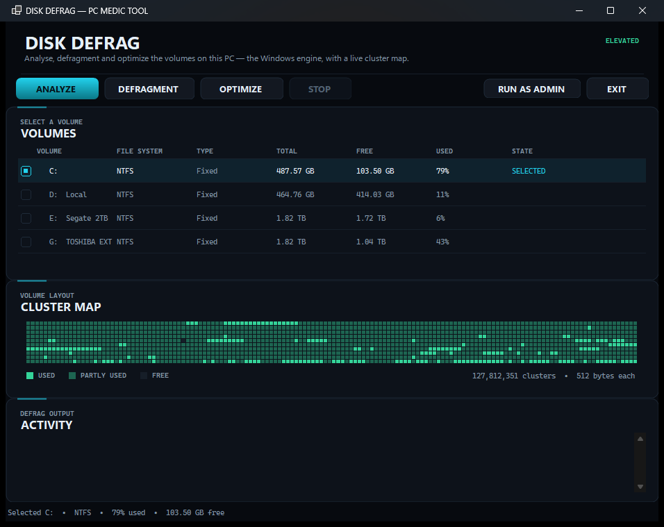

# Disk Defrag — cluster-map defragmentation for Windows

[](https://github.com/DwainSnickles/disk-defrag/actions/workflows/build.yml) [](https://github.com/DwainSnickles/disk-defrag/releases/latest)

**Disk Defrag** is a free, portable disk defragmentation front-end for Windows 10/11 with a
live cluster map, streamed `defrag.exe` output and a volume table that shows what the old
tools hide. It is the standalone companion to **[PC Medic](https://github.com/DwainSnickles/pc-medic)**,
and it installs nothing: one executable, no service, no background process.

It is built for people replacing **AML Free Disk Defrag**, Defraggler,
Auslogics Disk Defrag or IObit Smart Defrag — same workflow (select volume, Analyse,
Defragment, Optimise, watch the map), without adverts or a bundled "cleaner".



## Features

- **Volume table** — every fixed and removable volume with file system, label, total/free
  space and used percentage; click a row to target it.
- **Analyse / Defragment / Optimize** — drives the Windows storage optimiser directly
  (`defrag /A`, `/D`, `/O`) and streams its output into the activity log line by line.
- **Stop** — terminates the running `defrag.exe` process tree.
- **Live cluster map** — read from the NTFS allocation bitmap
  (`FSCTL_GET_VOLUME_BITMAP`) and the volume geometry (`FSCTL_GET_NTFS_VOLUME_DATA`),
  sampled into ~16,000 cells with a free / partly-used / fully-used legend.
- **Honest failure states** — `defrag.exe` reports privilege problems as text while still
  exiting 0, so the tool reads the output and says "refused — needs an elevated session"
  instead of claiming success. The cluster map explains itself when the volume cannot be
  opened rather than drawing a placeholder.
- **RUN AS ADMIN** — relaunches through UAC when you want the analysis or defragmentation
  to actually run.

## Requirements

- Windows 10 or 11, NTFS volume for the cluster map
- .NET 10 desktop runtime, or the .NET 10 SDK to build
- Administrator rights for the cluster map, Analyse, Defragment and Optimize

## Build

```sh
dotnet build "DiskDefrag.csproj"
```

The project builds into `../bin/$(Configuration)/net10.0-windows/` so that the executable
lands next to `PC Medic.exe` when the two are used as a suite. Run it on its own by copying
`DiskDefrag.exe` plus its `.dll` and `.runtimeconfig.json` anywhere you like.

## SEO / search terms

`free disk defrag` · `disk defragmentation Windows 11` · `AML Free Disk Defrag alternative` ·
`Defraggler alternative` · `Auslogics Disk Defrag alternative` ·
`IObit Smart Defrag alternative` · `Advanced SystemCare alternative` ·
`cluster map defrag` · `NTFS defragment tool` · `portable defrag` · `defrag with cluster map`

## Repository topics

`disk-defrag` `defragmentation` `cluster-map` `ntfs` `windows` `windows-11` `portable`
`winforms` `dotnet` `storage-optimizer` `aml-disk-defrag-alternative`
`defraggler-alternative` `advanced-systemcare-alternative` `freebuff`

## Part of the PC Medic suite

PC Medic is the wider portable maintenance suite (cleanup, startup audit, registry audit,
shortcut audit, power tuning). Its Maintenance page launches this tool when the executables
sit side by side: **[github.com/DwainSnickles/pc-medic](https://github.com/DwainSnickles/pc-medic)**.

---

Built with **[Freebuff](https://freebuff.com)** — the AI coding agent that builds and
maintains this suite.
